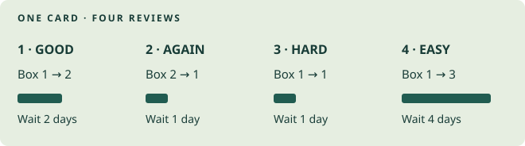

# Leitner Trace

How does a flashcard app choose the next review date? Change a single answer and see how that choice changes every date that follows. This small lab runs in **English or فارسی**, in your browser or terminal. No accounts, dependencies, API keys, uploads, or build step.



## Try it

**No-install browser edition:** [Download the offline lab (.zip)](https://github.com/MohammadaliMasjedi-source/MohammadaliMasjedi-source/raw/refs/heads/main/projects/leitner-trace/download/leitner-trace.zip), unzip it, and double-click **Leitner-Trace.html**. All code and styles are inside that file. No local server needed. برای استفادهٔ فارسی، فایل را باز کنید و روی «فارسی» بزنید.


**Terminal** — from the downloaded or cloned folder, with modern Node.js:

```sh
node cli.js 2028-02-28 good,again,hard,easy
node cli.js 2028-02-28 good,again,hard,easy --ladder 1,3,8 --json
npm test
```

**Browser for development** — from the same folder, serve the files on your own computer:

```sh
python3 -m http.server 8000 --bind 127.0.0.1
```

Open <http://127.0.0.1:8000/>. For the Persian interface, select **فارسی**, or open <http://127.0.0.1:8000/?lang=fa>. No internet connection is needed after download. The editable source uses relative ES modules that need a local server; the downloadable single-file edition embeds them. To rebuild the download with Python 3, run `python3 build_download.py`. Stop it with Ctrl+C.

**What to try:** in the default example, replace the second answer (`again`) with `easy`. Compare the due dates and box moves. Undo the change with **Reset example**. When chart bars look similar across two experiments, compare the numeric day counts: each chart scales to its own longest wait.

**Compare three schedules:** [Same answers, different review calendars](study/README.md) explores why two scripts with the same number of lapses can yield 20 or 40 reviews in 60 days. Includes the full dataset, timeline and an offline reproduction command.

## The exact rule

A new card starts in box 1. Each box has a delay: **1, 2, 4, 9, 21 days** by default. The answer selects the **new** box, whose delay sets the next review date. `again` resets to 1; `hard` stays put; `good` advances one; `easy` advances two. No move passes the last box.

| Review date | Answer | Box move | Wait | Next review |
|---|---|---|---:|---|
| 2028-02-28 | good | 1 → 2 | 2 days | 2028-03-01 |
| 2028-03-01 | again | 2 → 1 | 1 day | 2028-03-02 |
| 2028-03-02 | hard | 1 → 1 | 1 day | 2028-03-03 |
| 2028-03-03 | easy | 1 → 3 | 4 days | 2028-03-07 |

This is a **simulation of on-time reviews**, not a reminder app, a model of memory retention, FSRS, or an Anki integration. The dates use the UTC calendar; February 2028 has 29 days. To study actual, irregular review dates, call the lower-level scheduler with each real review date.

## Reuse in another project

```js
import { trace } from './trace.js';
const plan = trace({ start: '2028-02-28', grades: ['good', 'again'] });
console.log(plan.nextDue); // 2028-03-02
```

The returned object contains `start`, `ladder`, `rows` and `nextDue`. Each row contains `review` (index), `reviewed`, `grade`, `from`, `to`, `days` and `due`. Dates are required in `YYYY-MM-DD` format. You can supply up to 200 grades and a nondecreasing ladder of 1–32 positive whole-day intervals (at most 3,650 days each). The trace neither changes your inputs nor reads the clock.

For your own cards, import `createCard`, `schedule`, and `dueCards` from [srs.js](srs.js). Their optional date defaults to the current date, so pass explicit ISO dates for repeatable results. They preserve custom card fields.

## فارسی

فاصله‌ها از **جعبهٔ مقصد** حساب می‌شوند. اگر پاسخ «سخت» باشد کارت همان‌جا می‌ماند؛ پاسخ «یادم نبود» آن را به جعبهٔ اول برمی‌گرداند. در صفحهٔ فارسی هم پاسخ‌ها را با کلمات انگلیسی وارد کنید؛ هم ویرگول انگلیسی و هم «،» پذیرفته می‌شود. جدول، تاریخ هر مرور و تاریخ دفعهٔ بعد را نشان می‌دهد. برای تغییر تاریخ شروع از انتخاب‌گر تاریخ استفاده کنید.

## Contribute

A useful first contribution is a minimal grade sequence that exposes an unclear date or box transition. Include the starting date, ladder, grades, expected rows and actual rows. Add a failing test for a scheduling change and run `npm test`. Translation improvements are welcome; preserve the underlying grade names across languages.

MIT licensed. The scheduling engine is adapted from the author's earlier MIT-licensed Leitner core; this lab adds a trace API, a terminal interface, and an English/Persian browser explorer. See [LICENSE](LICENSE).
