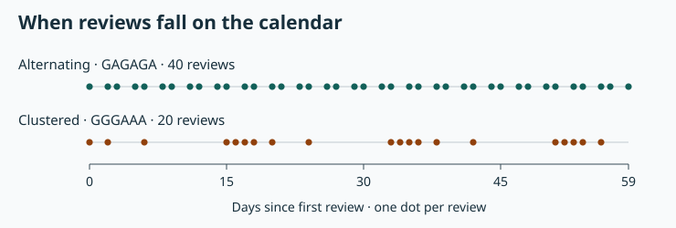

# Same answers, different review calendars

When two schedules see exactly the same answers in the same order, how much can their review workloads differ? This offline experiment runs the existing Leitner Trace engine on an exhaustive, deliberately small set of invented scripts. It measures dates a rule assigns. No learners, tracking, fitted parameters or external datasets are involved.

**Try predicting the result.** Take a new card and answer `G A G A G A` repeatedly. For another new card answer `G G G A A A` repeatedly (`G` = good, `A` = again). Both scripts contain three lapses every six reviews. In 60 days the default rule gives the first card **40** reviews and the second **20**. In the alternating script the card repeatedly waits two days, then one. In the clustered script three consecutive successes can reach a nine-day interval; the three subsequent lapses each schedule a one-day wait. The order changes calendar time, even when lapse counts match.



## Two questions with different denominators

1. **Fixed time:** How many reviews occur on calendar days 0 through 59? The first review occurs on day 0. A review due exactly on day 60 is outside the window.
2. **Fixed answers:** On what day does review 12 occur, and when is the next review due after it? Every policy receives the *same first 12 answers*. This second comparison still runs when review 12 falls outside the 60-day window.

Each of the 64 ordered six-letter scripts (all possible A/G words) repeats as long as needed. Every policy sees the same script **indexed by review number**, not by calendar date. Rotations are intentionally distinct: the card always starts in box 1, so the first answer matters. Reviews occur exactly when due. The calendar begins on 28 February 2028 UTC, crosses a leap day, and ignores time of day. By construction the shortest wait is one day, so 60 generated grades suffice to cover the window.

| ID | Days by destination box | Interpretation |
|---|---|---|
| default5 | 1, 2, 4, 9, 21 | Existing Leitner Trace default |
| doubling5 | 1, 2, 4, 8, 16 | Comparison ladder, shorter upper intervals |
| fixed4 | 4 | Nonadaptive reference: a review every four days |

A good answer advances by one box, capped at the last. Again resets to box 1. For a one-box rule, both answers stay in that box. These are transparent rules for comparison, not implementations of other named schedulers.

## Results

| Rule | Reviews in 60 days, min–max across scripts | Total reviews, one card per script | Fewer / equal / more reviews than default, paired by script |
|---|---:|---:|---:|
| default5 | 6–60 | 1,927 | 0 / 64 / 0 |
| doubling5 | 6–60 | 1,954 | 0 / 49 / 15 |
| fixed4 | 15–15 | 960 | 51 / 0 / 13 |

The smaller upper intervals of doubling5 produced more reviews for 15 scripts, but both schedules have the same overall range. Fixed4 asks less of many scripts and more of others. For an all-good script the default and doubling rules both fit six reviews into the window; their next dates after 12 reviews are **day 204** and **day 158**. This is why the study reports both fixed-time and fixed-answer outcomes. [All paired rows](workload.csv) · [policy summary](summary.csv).

## Reproduce or change the experiment

From the `projects/leitner-trace` directory with Node 18+ (no install required):

```sh
node study/workload.js --summary
node study/workload.js > my-workload.csv
node study/timeline.js > my-timeline.svg
node --test
```

The public CSV is deterministic (UTF-8, comma-separated, LF). The tests compare a fresh run against both checked-in CSVs and check all 192 cases against a separate integer event calendar that counts consecutive successes rather than using scheduler calls. To inspect an individual case manually, e.g. the day after 12 clustered-script reviews, run:

```sh
node cli.js 2028-02-28 good,good,good,again,again,again,good,good,good,again,again,again
```

`script` is the repeating word and `again_per_6` counts its As. `reviews_d0_d59` counts reviews in the fixed window. `review12_day` and `next_after12_day` are offsets from day zero, not dates. The two `minus_default` columns subtract the matching default value for the *same* script. In the summary, the equal-weight total is an artificial 64-card deck; it is not an estimate of a typical learner.

## What the experiment cannot tell you

A longer interval could change a real person's next answer. Here answers are fixed by construction, so neither fewer reviews nor longer spacing is evidence of better recall or learning efficiency. There is no distribution of learner behavior behind these 64 scripts; no p-value, confidence interval, learning benefit or generalization to delayed reviews is implied. Six-step periodic scripts also exclude irregular patterns, interruptions and all grades other than good/again. For a stronger claim about learning, you would need a separate design measuring recall at matched times, with appropriate consent and a defensible comparison of schedules.

[Compare this experiment with SM-2, FSRS, and empirical spacing research](RELATED-WORK.md).

## فارسی

اگر کارت هر بار دقیقاً در موعدش مرور شود، ترتیب پاسخ‌ها چه اثری روی تعداد مرورها دارد؟ در این آزمایش هر سه روش همان رشتهٔ پاسخ‌های ساختگی را به‌ترتیب می‌بینند. با روش پیش‌فرض، تکرار «درست، غلط، درست، غلط، درست، غلط» در ۶۰ روز ۴۰ مرور می‌سازد؛ تکرار «درست، درست، درست، غلط، غلط، غلط» فقط ۲۰ مرور. سه پاسخ درست پیاپی کارت را به فاصلهٔ نُه‌روزه می‌رساند. هر نقطهٔ شکل یک مرور است. برای دیدن خلاصه، از پوشهٔ پروژه دستور `node study/workload.js --summary` را اجرا کنید. روز صفر حساب می‌شود، روز شصتم نه. این‌ها دادهٔ افراد یا سنجش حافظه نیستند؛ مرور کمتر لزوماً به معنی یادگیری بهتر نیست.

Code, illustrations and enumerated synthetic outputs in this folder are covered by the project's [MIT license](../LICENSE).
